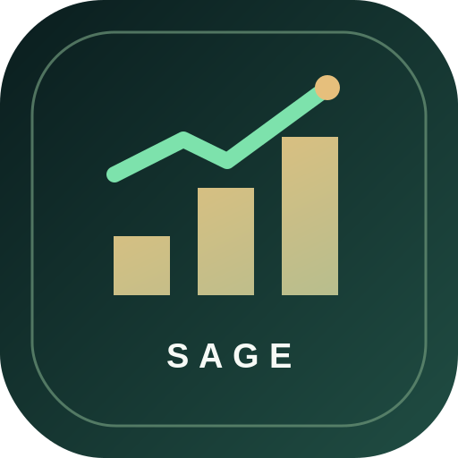
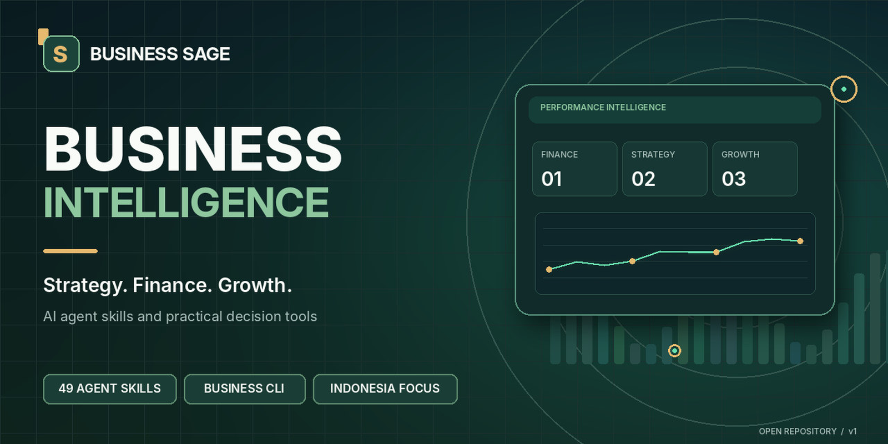
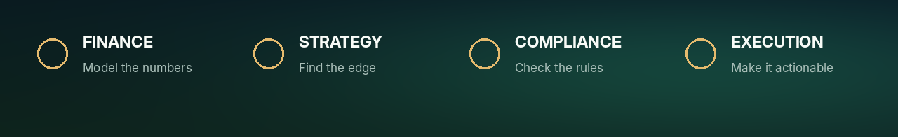
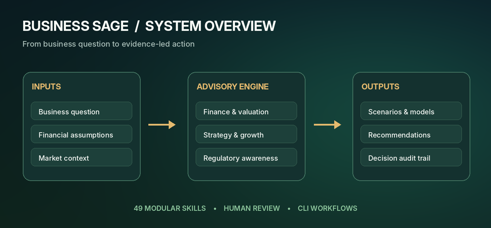
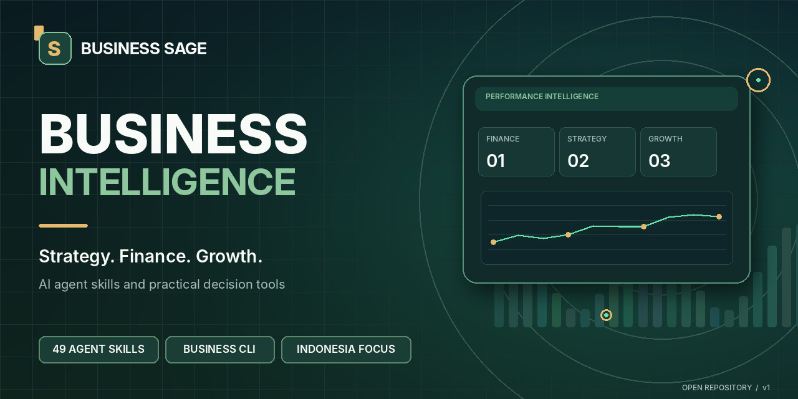

<div align="center">



# BUSINESS SAGE

### Business Intelligence · Financial Strategy · Indonesian UMKM & Tax Scenarios · 49 Agent Skills

**An open repository of 49 collaborative AI agent skills led by an internet-researched S1–S2 Business & Financial Advisory Co-Pilot (`business-sage`) and zero-MCP Python CLI (`bsage`).**



[](./CHANGELOG.md)
[](https://github.com/NousResearch/hermes-agent)
[](#multi-agent-compatibility-hermes-1-openclaw-chatgpt-claude--more)
[](./skills/cli-anything-business-sage/SKILL.md)
[](./docs/SKILLS_CATALOG.md)
[](./LICENSE)
[](https://saweria.co/muzas)

[](https://gemini.google.com)
[-F59E0B?style=flat-square)](https://github.com/zidanaisar624)

[**Instalasi Cepat**](./docs/INSTALLATION.md) · [**Katalog 49 Skills**](./docs/SKILLS_CATALOG.md) · [**Referensi CLI (`bsage`)**](./docs/CLI_REFERENCE.md) · [**Buku Referensi Bisnis**](./docs/BUKU_REFERENSI_LENGKAP_BUSINESS_SAGE_S1_S2_DAN_PAJAK_INDONESIA.md) · [**Setup GitHub & Social Preview**](./docs/GITHUB_SETUP.md)

</div>

---

> **Summary (English)**: *Business Sage + 49 Collaborative AI Agent Skills: featuring an internet-researched S1–S2 (BBA/FEB & MBA/MM) Strategy, Corporate Finance & Indonesian UMKM/Tax Advisory Co-Pilot (built with deep respect for business students, certified practitioners & human entrepreneurs—NEVER a replacement) + Eternal-Student Trend Forecasting & Rp0-Bootstrap CLI. Native CLI-Anything zero-MCP ready for Hermes (#1), OpenClaw, ChatGPT & Claude. Born from a fun experiment, architected by Google Gemini, and 100% free to use.*

---

> [!IMPORTANT]
> ### Penghormatan untuk Anak Kuliah Bisnis, Praktisi & Pengusaha: *Advisor* Riset, BUKAN Pengganti Manusia!
> Skill utama **`business-sage`** di repositori ini disusun semata-mata dari **penelusuran, riset, dan rangkuman literatur publik di internet** mengenai *Financial Literacy*, materi kuliah **S1 Bisnis/Manajemen/Akuntansi (BBA/FEB)**, **S2 Magister Manajemen/MBA**, serta dokumen regulasi publik ekonomi/UMKM/perpajakan Indonesia.
>
> Kami menaruh **rasa hormat setinggi-tingginya kepada mahasiswa & lulusan sekolah bisnis (*anak bisnis* FEB/Manajemen/Akuntansi/MBA/MM), peneliti doktoral, Akuntan Publik (CPA), Konsultan Pajak Resmi (USKP), Perencana Keuangan (CFP), Konsultan Hukum, serta para pengusaha & pelaku UMKM di lapangan**. Kumpulan rumus dan catatan internet di dalam AI **tidak pernah diklaim setara dan tidak akan pernah menggantikan** tempaan nyata di bangku kuliah bisnis (bedah ratusan *case study*, riset pasar langsung ke jalan, debat strategi, kompetisi bisnis & magang), intuisi negosiasi *founder* saat menjaga arus kas nyata, maupun lisensi dan tanggung jawab hukum profesi resmi.
>
> Karena itu, **Business Sage hadir dengan rendah hati sebagai *Strategic & Financial Co-Pilot* / Teman Diskusi Riset & Kalkulator Skenario**—sementara keputusan bisnis, etika usaha, verifikasi pajak/hukum resmi (DJP/OSS/JDIH), dan kepemimpinan tetap **100% milik manusia**.

---

## Mengapa Business Sage?



| Pilar Utama | Apa yang Dibantu (Sebagai *Advisory Co-Pilot*) | Modul di Repositori Ini |
| :--- | :--- | :--- |
| **1. Financial Literacy & Corporate Finance** | Audit anggaran `50/30/20`, dana darurat `3–6 bulan`, *Contribution Margin*, `BEP`, `Gross-Margin LTV:CAC`, `Payback`, `CCC`, serta skenario `FCFF / WACC / Intrinsic DCF` | [`s1-s2-mba-global-and-financial-literacy.md`](./skills/business-sage/references/s1-s2-mba-global-and-financial-literacy.md) |
| **2. Konteks Ekonomi, UMKM & Pajak Indonesia** | Pemetaan awal skala UMKM (`PP 7/2021`), perbandingan skenario PPh (`PP 20/2026` 0,5% WP OP / PT Perorangan / Koperasi vs `Pasal 31E` 11% laba bersih CV/PT), `OSS-RBA`, `SAK IAI`, `QRIS`, Halal `BPJPH`, & `PKWT PP 35/2021` | [`indonesia-economic-tax-legal-system.md`](./skills/business-sage/references/indonesia-economic-tax-legal-system.md) |
| **3. Prediksi Tren, Celah Untung & Modal Rp0** | Pemodelan adopsi **Bass Diffusion S-Curve** ($t^* = \frac{\ln(q/p)}{p+q}$), *Geo-Lag Arbitrage*, 6 pemindai *Profit-Gap*, dan 5 skema *bootstrap* **Negative CCC ($\text{CCC} < 0$)** | [`trend-prediction-profit-gaps-and-zero-rupiah.md`](./skills/business-sage/references/trend-prediction-profit-gaps-and-zero-rupiah.md) |
| **4. Psikologi Pelanggan & *Consultative Closing*** | *The Mom Test*, *Jobs-to-be-Done (4 Switching Forces)*, *SPIN Selling*, *Chris Voss Tactical Empathy*, & skrip WhatsApp sopan khas Indonesia (**5-Step WARMTH Flow**) | [`customer-psychology-sales-and-phd-loop.md`](./skills/business-sage/references/customer-psychology-sales-and-phd-loop.md) |
| **5. Eternal-Student CLI & Sinergi 49 Skills** | Belajar aplikasi/CLI baru yang disambungkan (`bsage onboard-app`), mencatat hipotesis bisnis (`phd_business_ledger/`), bekerja hemat token tanpa MCP berat, & berkolaborasi lintas **49 skills** | [`cross-skill-synergy-and-new-app-onboarding.md`](./skills/business-sage/references/cross-skill-synergy-and-new-app-onboarding.md) |

---

## Arsitektur Kerja & Efisiensi Token (`CLI-Anything` Zero-MCP Ready)



Alur kerja yang direkomendasikan: **Pertanyaan Bisnis → Eksplisitkan Asumsi → Hitung Skenario via CLI (`--json`) & Riset Lintas-Skill → Opsi Strategi → Keputusan Manusia**.

- **Tanpa Boros Token MCP**: Mengikuti konvensi [HKUDS/CLI-Anything](https://github.com/HKUDS/CLI-Anything), agen menjalankan perhitungan keuangan, pajak skenario, prediksi tren, dan *onboarding* aplikasi baru langsung via CLI deterministik (`bsage --json ...`) dengan **0 idle context token**.
- **Eternal Business Student**: Setiap kali aplikasi baru dihubungkan (misal `libreoffice`, `sqlite3`, atau harness `CLI-Anything` baru) atau diperbarui, jalankan `bsage onboard-app --app <nama-app>` agar agen mengenali perubahan versinya sebelum dipakai menganalisis data.

---

## Multi-Agent Compatibility (Hermes #1, OpenClaw, ChatGPT, Claude & More)

| Ekosistem AI Agent | Dukungan & Lokasi Sinkronisasi | Catatan Keamanan |
| :--- | :--- | :--- |
| **1. Hermes Agent (#1)** | Auto-scan semua partisi drive (`C:`–`Z:`), Registry, WSL, & seluruh profil Bot Mode (`profiles/*`) | **100% TIDAK MENYENTUH** `config.yaml`, `provider`, `model`, atau `SOUL.md`! |
| **2. OpenClaw** | Sinkronisasi otomatis ke `~/.openclaw/skills` (`$OPENCLAW_HOME`) | Format `SKILL.md` standar murni. |
| **3. ChatGPT (Custom GPTs, Projects & Codex)** | Bundle siap upload di [`exports/chatgpt/`](./exports/chatgpt/) + auto-sync ke `~/.codex/skills` | Tinggal *copy-paste* instruksi & upload 1 file Knowledge Base. |
| **4. Claude (Claude Code & Claude Projects)** | Plugin manifest [`.claude-plugin/`](./.claude-plugin/marketplace.json), `~/.claude/skills`, & [`adapters/claude/`](./adapters/claude/CLAUDE_PROJECT_GUIDE.md) | Siap dipakai via `/plugin marketplace add` maupun Claude Projects. |
| **5. Cursor & Universal Agents** | [`AGENTS.md`](./AGENTS.md), [`.cursor-plugin/`](./.cursor-plugin/marketplace.json), & `~/.agents/skills` | Kompatibel dengan seluruh agen berstandar `agentskills.io`. |

---

## Instalasi Otomatis Pintar & Update 1-Perintah di Terminal (`PowerShell` & `CMD`)

Installer otomatis menyesuaikan diri dengan kompleksitas partisi disk komputer user mana pun (mendukung **Smart Auto-Discovery** lintas semua drive maupun **Target Eksplisit**):

### 1. Instalasi Pertama Kali

**Opsi A — Otomatis Mencari Hermes & Multi-Agent di Komputer User (Direkomendasikan):**
```powershell
# Windows PowerShell (Pasang 2 skill inti Business Sage atau tambah -Scope all untuk seluruh 49 skills)
.\install_business_sage.ps1
.\install.ps1 -Scope all
```
```bash
# Linux / macOS / WSL
bash ./install_business_sage.sh
bash ./install.sh
```

**Opsi B — Memilih Satu Folder Target Secara Eksplisit (Dengan Mode Preview `-WhatIf` / `--dry-run`):**
```powershell
.\install_business_sage.ps1 -TargetSkillsDir "$HOME\.hermes\skills" -Scope business -WhatIf
.\install_business_sage.ps1 -TargetSkillsDir "$HOME\.hermes\skills" -Scope business
```

### 2. Cek & Update Otomatis dari Terminal (Tanpa Perlu Buka Browser GitHub!)

Setelah terpasang, perintah global `bsage` (serta alias `business-sage`, `cli-anything-business-sage`, dan `business-sage-update`) aktif di **PowerShell** maupun **CMD** dari direktori mana saja:

```powershell
# Cek apakah ada update terbaru di GitHub
bsage check

# Tarik update terbaru dari GitHub & sinkronkan otomatis ke Hermes + semua Agent
bsage update

# Cek status instalasi Hermes (root + bot profiles) & agent lain
bsage status
```

---

## Contoh Eksekusi CLI (`--json` untuk AI Agent & Terminal)

```bash
# 1. Audit Unit Economics (Contribution Margin, BEP, Gross-Margin LTV:CAC & Payback)
bsage --json unit-economics --price 250000 --variable-cost 100000 --monthly-fixed-cost 15000000 --cac 150000 --monthly-churn-rate 0.05

# 2. Valuasi Intrinsik DCF 5 Tahun (FCFF, WACC, Enterprise & Equity Value)
bsage --json valuation-dcf --initial-fcff 500000000 --growth-rate-5yr 0.18 --terminal-growth-rate 0.04 --wacc 0.11 --cash 120000000 --debt 50000000

# 3. Simulasi Skenario Skala UMKM (PP 7/2021) & Pajak Indonesia (PP 20/2026 vs Pasal 31E)
bsage --json indonesia-tax-legal --annual-turnover-idr 2400000000 --annual-net-profit-idr 300000000 --entity-type pt_perorangan

# 4. Prediksi Fase Adopsi Tren Bisnis (Bass Diffusion S-Curve & Geo-Lag Arbitrage)
bsage --json predict-trend --sector "AI Workflow untuk UMKM Indonesia" --current-adoption-pct 10

# 5. Rencana Bootstrap Modal Rp0 (Negative CCC < 0) + Skrip WhatsApp 5-Step WARMTH
bsage --json zero-rupiah-plan --skill-or-network "Otomasi & Data Analytics" --target-market "Klinik & F&B Lokal" --target-monthly-profit-idr 15000000

# 6. Eternal-Student App Onboarding & Pemetaan Kolaborasi 49 Skills
bsage --json onboard-app --app libreoffice
bsage --json synergy
```

---

## Struktur Repositori

```text
.
├── assets/                 # Branding resmi Business Sage (logo, hero, pilar, arsitektur, social preview 1280x640)
├── business-sage/          # Paket namespace Python CLI (`cli_anything.business_sage`) & suite pengujian `test_core.py`
├── skills/                 # 49 skill kolaboratif (`business-sage`, `cli-anything-business-sage` + 47 peer skills)
├── adapters/ & exports/    # Instruksi & Knowledge Base siap pakai untuk ChatGPT & Claude Projects
├── .claude-plugin/         # Manifest plugin Claude Code Marketplace
├── .cursor-plugin/         # Manifest plugin Cursor
├── docs/                   # Panduan instalasi, katalog 49 skills, buku referensi bisnis, akurasi & setup GitHub
├── install.ps1 / .bat / .sh & install_business_sage.ps1 / .sh
├── update.ps1 / .bat / .sh # Self-updater terminal tanpa buka browser
└── push_to_github.ps1      # Helper publikasi aman ke GitHub (tanpa --force)
```

---

## Social Preview di GitHub (Langkah Terpisah di Settings)



GitHub **tidak** otomatis memasang gambar kartu *link preview* hanya dari commit file. Setelah repo dibuat di GitHub, buka **Repository → Settings → Social preview → Edit → Upload an image...** lalu pilih [`assets/github_social_preview_1280x640.jpg`](./assets/github_social_preview_1280x640.jpg) (`1280 × 640 px`, `< 1 MB`). Lihat panduan lengkap di [`docs/GITHUB_SETUP.md`](./docs/GITHUB_SETUP.md).

---

## Dukung Pengembangan / Support

[](https://saweria.co/muzas)

Proyek inti **Business Sage** tetap **open-source** dan bebas digunakan oleh siapa saja. Jika bermanfaat, dukungan sukarela melalui [Saweria (`https://saweria.co/muzas`)](https://saweria.co/muzas) membantu kelanjutan riset serta pembaruan rutin repositori ini.

---

## Lisensi & Catatan Akurasi

Dirilis di bawah lisensi terbuka **[MIT License](./LICENSE)** — bebas digunakan, dipelajari, dan dikembangkan oleh siapa saja. Seluruh perhitungan keuangan, pajak, dan proyeksi di repositori ini adalah alat bantu analisis skenario edukatif, bukan nasihat investasi, audit, pajak, atau hukum berlisensi; baca [`docs/ACCURACY_AND_RISK.md`](./docs/ACCURACY_AND_RISK.md).

---
<div align="center"><strong>BUSINESS SAGE</strong> · Strategy. Finance. Growth.</div>
